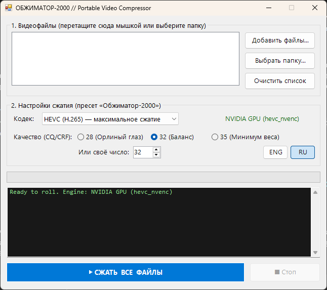
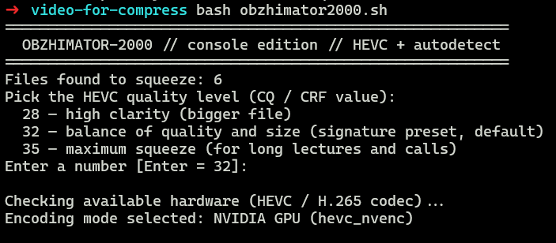

[English](README.md) | **Русский**

<p align="center">
  
  
</p>

```text
════════════════════════════════════════════════════════════════════════════
  ___  ____ ______   _ ___ __  __    _  _____ ___  ____
 / _ \| __ )__  / | | |_ _|  \/  |  / \|_   _/ _ \|  _ \
| | | |  _ \ / /| |_| || || |\/| | / _ \ | || | | | |_) |
| |_| | |_) / /_|  _  || || |  | |/ ___ \| || |_| |  _ <
 \___/|____/____|_| |_|___|_|  |_/_/   \_\_| \___/|_| \_\

ОБЖИМАТОР-2000 // PORTABLE VIDEO COMPRESSOR // HEVC EDITION
POWERED BY FFMPEG // ZERO BLOATWARE // MAXIMUM COMPRESSION
════════════════════════════════════════════════════════════════════════════

Это не новый кодировщик, а удобная оболочка над ffmpeg: выбор пресета,
автодетект железа и пакетная обработка. Всю тяжёлую работу делает FFmpeg.

[0x01] ЧТО ЭТО ЗА ЗВЕРЬ?
------------------------
Хватит кормить жирные GUI-комбайны с телеметрией, подписками и кнопками
на пол-экрана! ОБЖИМАТОР-2000 — портативный конвейерный сжиматель видео
на стероидах: кодек HEVC (H.265), ноль установок, а твои файлы худеют
на 90–96%. Родился в WSL2 на Windows 11 как обычный консольный скрипт,
потом обзавёлся окошком с кнопочками — для тех, кто впадает в нервный
тик при виде чёрных терминалов.
Два инструмента в комплекте:
  - obzhimator2000.sh  — консольный демон для Linux и WSL2;
  - obzhimator2000.bat — окошко с кнопочками для Windows (полиглот
    .bat + PowerShell, никаких установок).
Пресет вдохновлён Ironclad из CompressO (респект авторам), но имя у нас
теперь своё, родное.
Исходники НЕ трогает (мы же не звери). Готовые файлы аккуратно кладёт
в подпапку ./compressed/ рядом с оригиналами.

[0x02] СИСТЕМНЫЕ ТРЕБОВАНИЯ (ЗАВИСИМОСТИ)
-----------------------------------------
1. Прямые руки (опционально — для владельцев лапок добавлен GUI).
2. FFmpeg в системе:
   - Linux / WSL2:  sudo apt update && sudo apt install ffmpeg -y
   - Windows:       winget install Gyan.FFmpeg  (или просто кинь
                    ffmpeg.exe рядом с obzhimator2000.bat — найдёт сам).
3. Windows 10/11 со встроенным PowerShell 5.1 — для GUI-версии;
   bash 4+ — для консольной.
4. Свежие дрова на видеокарту, если хочешь аппаратный разгон.
   Нет видюхи — не беда: сожмёт на процессоре, просто медленнее.

[0x03] КОНСОЛЬНЫЙ РЕЖИМ: obzhimator2000.sh (ДЛЯ НАСТОЯЩИХ ХАКЕРОВ)
------------------------------------------------------------------
Кинь скрипт в папку с видосами (.mp4, .mkv, .mov, .avi, .webm) и запусти:
1. Один раз выдай право на исполнение (если скрипт лежит на Linux-разделе):
   $ chmod +x obzhimator2000.sh
2. Поехали:
   $ ./obzhimator2000.sh
   Хочешь сжать только выбранные файлы? Передай их аргументами:
   $ ./obzhimator2000.sh lecture1.mp4 lecture2.mkv
   Без аргументов — берёт все видеофайлы в текущей папке.
   Язык: сообщения берутся из локали системы (русская -> ru, любая
   другая -> en). Принудительно:
   $ ./obzhimator2000.sh --lang en
3. Если видео лежат на виндовом диске (/mnt/c/...) под WSL2 — запускай так:
   $ bash obzhimator2000.sh
Скрипт спросит уровень качества, сам определит железо
(NVENC -> QSV -> VAAPI -> CPU), а в конце выдаст итоговый отчёт.
Ctrl-C останавливает конвейер и удаляет недожатый огрызок.
Внимание: правишь файл в виндовом редакторе? Сохраняй с окончаниями
строк LF, иначе bash на Linux подавится невидимым \r и откажется работать.

[0x04] GUI-РЕЖИМ: obzhimator2000.bat (ДЛЯ ВИНДУЗЯТНИКОВ С ЛАПКАМИ)
-------------------------------------------------------------------
Если от командной строки потеют ладони, а ввод цифр вызывает лёгкий
экзистенциальный кризис — специально для тебя мы собрали полиглот-
монстра весом в пару десятков килобайт: внутри .bat живёт скрипт
PowerShell, снаружи — обычный двойной клик (никаких Python, .NET-качалок
и прочей мишуры).
1. Делаешь двойной клик по obzhimator2000.bat.
2. Перетаскиваешь видосы или целую папку прямо в окно
   (да, Drag & Drop завезли).
3. Выбираешь кодек (HEVC для микро-веса или H.264 для древних тостеров)
   и тыкаешь радиокнопку качества.
4. Жмёшь синюю кнопку «СЖАТЬ ВСЕ ФАЙЛЫ» и идёшь пить смузи.
5. Передумал? Жми «Стоп» — программа прибьёт процесс и сама подчистит
   за собой недожатый битый огрызок.
6. Окно не растягивается мышкой. Это не баг, это ретро-фича: FixedSingle.
7. Интерфейс двуязычный: щёлкни переключатель ENG/RU в углу окна —
   и всё заговорит на твоём языке.

[0x05] НАСТРОЙКА КАЧЕСТВА (МАГИЧЕСКИЕ ЦИФРЫ CQ / CRF)
-----------------------------------------------------
Не тупи, выбирай уровень сжатия с умом:
28  — РЕЖИМ «ОРЛИНЫЙ ГЛАЗ». Максимальная чёткость, мелкий текст на
      скринкастах как бритва. Вес побольше, но всё равно в разы меньше
      оригинала.
32  — ЗОЛОТАЯ СЕРЕДИНА (по умолчанию). Глаз разницы не видит, а 6 ГБ
      скринкаста схлопываются в ~200–300 МБ (экономия 90–96%).
      Подходит для 99% задач.
35  — РЕЖИМ «ШАКАЛЫ НА МИНИМАЛКАХ» (но ещё смотрибельно). Для длинных
      лекций, созвонов и отправки в телегу, когда каждый мегабайт на
      счету.
Для H.264 цифры свои, гуманнее: 25 / 28 / 31 — программа подставит сама.
В GUI есть поле «Или своё число» (15–45); консоль принимает то, что
введёшь.

[0x06] ФИЧИ ПОД КАПОТОМ
-----------------------
[+] Кодек HEVC (H.265) + ключ -g 250: ключевой кадр раз в 10 секунд —
    статичный интерфейс экрана не раздувает файл, текст остаётся чётким.
[+] Тег совместимости hvc1: видосы в .mp4 нативно открываются в Windows,
    macOS, iOS, Android, VLC и Telegram без танцев с бубном.
[+] Умный автодетект железа: гоняет микро-тест на 1 кадр в память и
    выбирает лучший движок (NVENC -> QSV -> VAAPI -> CPU libx265/libx264).
[+] Конвейер: жмёт хоть 1 файл, хоть 100 подряд без твоего участия.
[+] Чистоплотность: ошибка или Ctrl-C — недожатый огрызок удаляется,
    битые файлы в ./compressed/ не копятся.
[+] Финальный отчёт: сколько гигов спас и сколько минут жизни сэкономил.

[0x07] НЮАНСЫ (ЧИТАЙ, ЧТОБЫ БЕЗ СЮРПРИЗОВ)
------------------------------------------
[-] На выходе всегда .mp4 в подпапке ./compressed/ рядом с оригиналом.
[-] Звук пережимается в AAC 128k — для речи и скринкастов за глаза.
[-] Частота кадров принудительно 25 fps (-r 25 в скриптах): привет из
    нулевых. Не нужно — найди строку с -r 25 и снеси её, никто не обидится.
[-] Повторный запуск по той же папке молча перезаписывает результаты (-y).
[-] Правишь .bat — сохраняй в UTF-8 без BOM; правишь .sh — сохраняй с LF.
    Иначе получишь кракозябры и «bad interpreter» соответственно.

[0x08] АВАРИЙНЫЙ ОТКАТ В H.264 (ДЛЯ ДРЕВНИХ КОМПОВ И БРАУЗЕРОВ)
---------------------------------------------------------------
Если пережатый HEVC понадобилось открыть на компе времён динозавров
или в старом веб-плеере, который не умеет в H.265 — перегони файл
обратно в классический H.264 (звук копируется мгновенно, без пережатия):
```

На процессоре (100% совместимость):

```bash
ffmpeg -i "video_hevc.mp4" -c:v libx264 -preset medium -crf 23 -pix_fmt yuv420p -c:a copy -movflags +faststart "video_h264.mp4"
```

На видеокарте NVIDIA (за пару секунд):

```bash
ffmpeg -i "video_hevc.mp4" -c:v h264_nvenc -preset p5 -rc vbr -cq 25 -pix_fmt yuv420p -c:a copy -movflags +faststart "video_h264.mp4"
```

```text
[0x09] ЛИЦЕНЗИЯ: ОТДАНО ВСЕМ И НАВСЕГДА
----------------------------------------
Общественное достояние (Unlicense). Копируй, меняй, продавай, встраивай
в коммерцию, форкай, выкладывай под своим именем — можно всё, навсегда,
бесплатно, без спроса и без отчётов. Автор сознательно отказался от всех
прав в пользу человечества. Гарантий никаких: если видеокарта от радости
пойдёт на взлёт — это твои личные отношения с видеокартой.
Полный текст лежит в файле LICENSE рядом с этим README.

[0x0A] ДИСКЛЕЙМЕР
-----------------
Скрипты написаны в образовательных и сугубо мирных целях для спасения
твоих SSD от ожирения. Делай бэкапы, хакер!
================================================================================
EOF // HAPPY COMPRESSING! // ОБЖИМАТОР-2000 FOREVER
================================================================================
```
